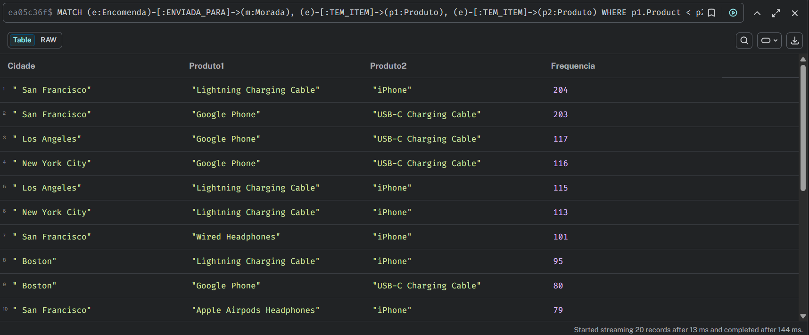
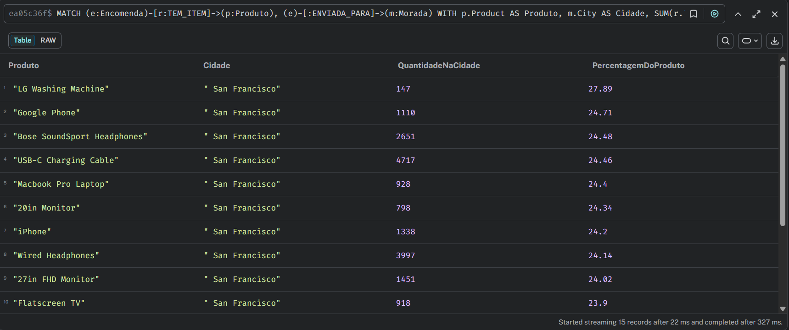
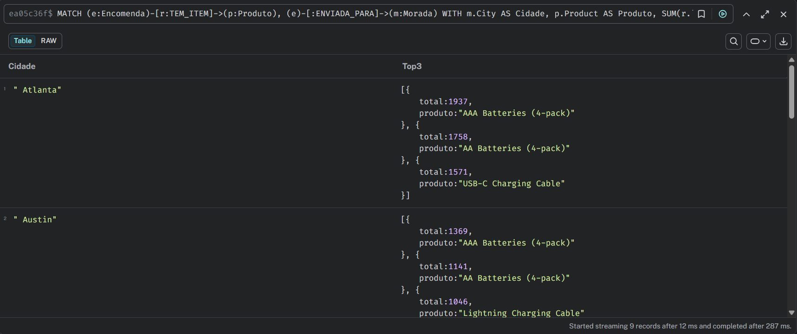

# Electronic Sales Analysis | Neo4j & Graph Databases

Projeto académico de **Big Data** centrado na análise de vendas de produtos eletrónicos através de uma **base de dados orientada a grafos**. Utiliza **Neo4j Aura**, o **Neo4j Data Importer** e a linguagem **Cypher** para explorar relações entre encomendas, produtos e cidades.

## Objetivo

O objetivo é transformar registos de vendas, originalmente organizados num ficheiro CSV, num grafo que facilite a análise das ligações entre entidades. Em vez de observar apenas cada venda isoladamente, o modelo permite investigar **que produtos são comprados em conjunto**, **como se distribuem as vendas por cidade** e **quais são os produtos mais vendidos em cada localização**.

Este projeto aplica conceitos de **bases de dados NoSQL orientadas a grafos**, **modelação de dados**, **importação de datasets** e **análise com Cypher**. Não inclui modelos de previsão ou aprendizagem automática.

## Tecnologias utilizadas

- **Neo4j Aura** — alojamento da base de dados em grafos na cloud.
- **Neo4j Data Importer** — definição do modelo e importação das linhas do CSV como nós e relações.
- **Cypher** — consulta, agregação e exploração dos dados no grafo.
- **CSV / JSON** — armazenamento dos dados, resultados e configuração da importação.

## Dataset

É utilizado o ficheiro [`data/Electronic_Sales.csv`](data/Electronic_Sales.csv), uma amostra de **99 999 registos de vendas de produtos eletrónicos**. Entre os campos disponibilizados estão:

| Campo | Significado |
| --- | --- |
| `Order ID` | Identificador da encomenda |
| `Product` | Produto adquirido |
| `Quantity Ordered` | Quantidade encomendada |
| `Price Each` | Preço unitário |
| `Sales` | Valor de venda registado |
| `City` | Cidade associada à compra |
| `Order Date`, `Month`, `Hour` | Informação temporal da encomenda |

O ficheiro contém **19 produtos**, **9 cidades** e **95 933 identificadores de encomenda distintos**. Fonte indicada no trabalho: [Electronic Sales — Kaggle](https://www.kaggle.com/datasets/anshulpachauri/electronic-sales).

## Modelação da base de dados

O modelo definido em [`model/neo4j_importer_model.json`](model/neo4j_importer_model.json) utiliza **três tipos de nós**:

- **`Encomenda`** — identificador (`Order ID`), valor (`Sales`), mês e hora.
- **`Produto`** — designação (`Product`).
- **`Morada`** — cidade (`City`); neste projeto, não representa a morada completa.

As entidades são ligadas através de **duas relações**:

- **`(Encomenda)-[:TEM_ITEM]->(Produto)`** — associa uma encomenda aos seus produtos e guarda `Quantity Ordered` e `Price Each` na relação.
- **`(Encomenda)-[:ENVIADA_PARA]->(Morada)`** — associa a encomenda à cidade de destino.


Esta estrutura permite seguir diretamente os percursos **cidade → encomenda → produto** e **produto → encomenda → outro produto**, úteis na análise de distribuição geográfica e compras conjuntas.

## Análises realizadas

As três consultas estão disponíveis em [`queries/analises.cypher`](queries/analises.cypher).

### 1. Produtos comprados em conjunto

Identifica **pares de produtos presentes na mesma encomenda**, agrupados por cidade, e ordena os pares pela frequência com que surgem juntos. O filtro `p1.Product < p2.Product` evita contabilizar o mesmo par em ambas as ordens.

**Aplicação:** identificar possíveis oportunidades de venda cruzada e combinações frequentes de produtos.



### 2. Concentração geográfica das vendas

Calcula, para cada produto, a **quantidade vendida por cidade** e a respetiva **percentagem do total desse produto**. Apresenta as combinações produto/cidade com maior concentração percentual.

**Aplicação:** perceber onde se concentra a procura por diferentes produtos. A consulta mede distribuição de vendas, não dependência causal da cidade.



### 3. Top 3 produtos por cidade

Soma `Quantity Ordered` para cada combinação de produto e cidade e devolve os **três produtos com maior quantidade vendida em cada cidade**.

**Aplicação:** comparar preferências de compra e identificar produtos mais populares por localização.



### Exemplo de Cypher

O seguinte exemplo devolve os três produtos mais vendidos em cada cidade:

```cypher
MATCH (e:Encomenda)-[r:TEM_ITEM]->(p:Produto),
      (e)-[:ENVIADA_PARA]->(m:Morada)
WITH m.City AS Cidade, p.Product AS Produto,
     SUM(r.`Quantity Ordered`) AS TotalVendido
ORDER BY Cidade, TotalVendido DESC
WITH Cidade, collect({produto: Produto, total: TotalVendido})[0..3] AS Top3
RETURN Cidade, Top3;
```

## Como executar

1. Criar uma base de dados no [Neo4j Aura](https://console.neo4j.io/) ou preparar uma instância Neo4j compatível.
2. Abrir o **Neo4j Data Importer** e importar [`model/neo4j_importer_model.json`](model/neo4j_importer_model.json).
3. Associar [`data/Electronic_Sales.csv`](data/Electronic_Sales.csv) à fonte de dados do modelo, caso seja necessário, e confirmar os mapeamentos e as restrições de unicidade.
4. Ligar o Data Importer à instância com **credenciais próprias** e executar a importação.
5. Abrir o editor de consultas do Neo4j e executar, **uma de cada vez**, as consultas em [`queries/analises.cypher`](queries/analises.cypher).
6. Consultar os exemplos de saídas guardados em [`results/`](results/) e as imagens em [`images/`](images/).

> **Nota:** não é preciso instalar bibliotecas Python para executar estas consultas. O projeto foi desenvolvido através das ferramentas do Neo4j. A importação não acontece automaticamente ao descarregar o repositório.

## Estrutura do repositório

```text
├── README.md
├── data/
│   └── Electronic_Sales.csv
├── model/
│   └── neo4j_importer_model.json
├── queries/
│   └── analises.cypher
├── results/           # Resultados das consultas em CSV
└── images/            # Diagrama e capturas das consultas
```

## Resultados e limitações

O projeto demonstra como a **representação em grafo** permite consultar compras conjuntas, distribuições geográficas e rankings de produtos usando as mesmas entidades e relações.

Os resultados apresentados são **descritivos** e dependem da amostra importada. O ficheiro disponível corresponde a uma parte do dataset de origem. As frequências e percentagens não estabelecem causalidade, e os resultados de clustering ou previsões futuras **não fazem parte deste projeto**.

Para mais detalhe sobre a implementação e a interpretação das consultas, consultar [`Relatorio.docx`](Relatorio.docx).
